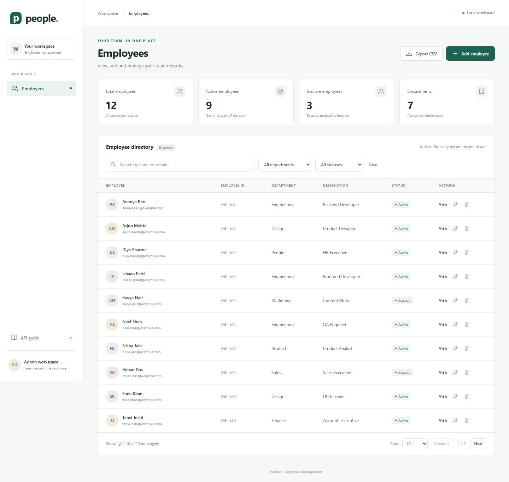
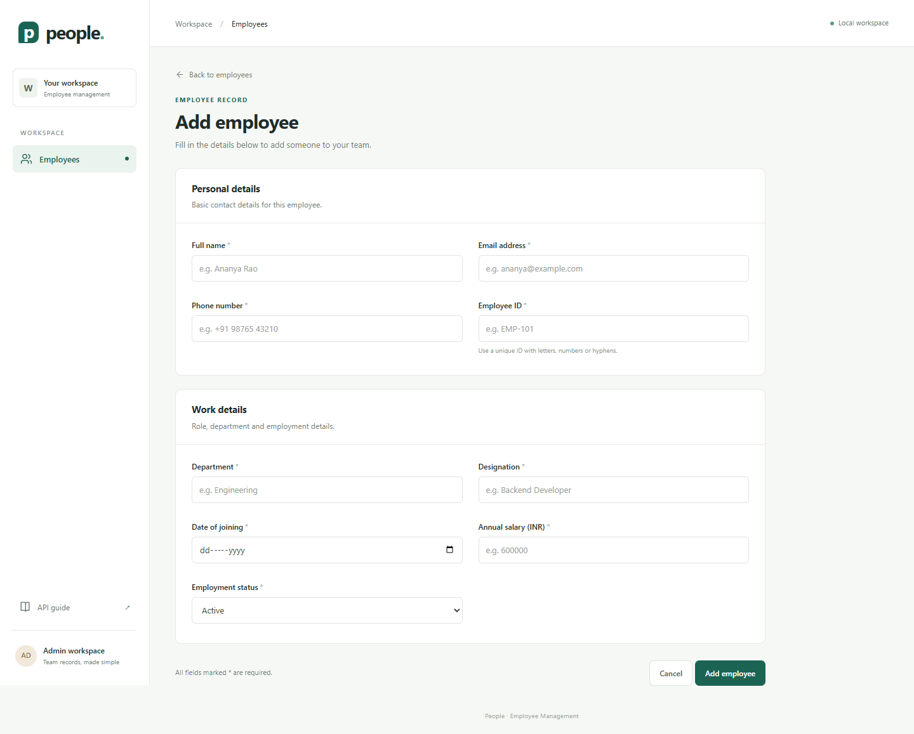
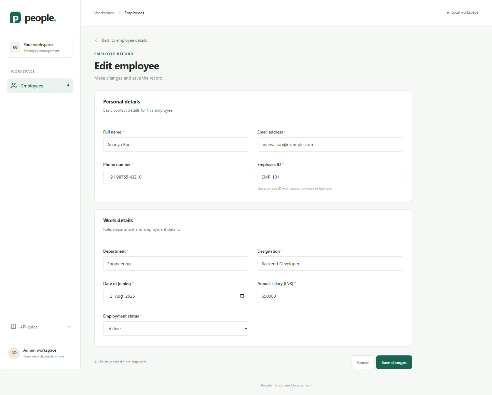
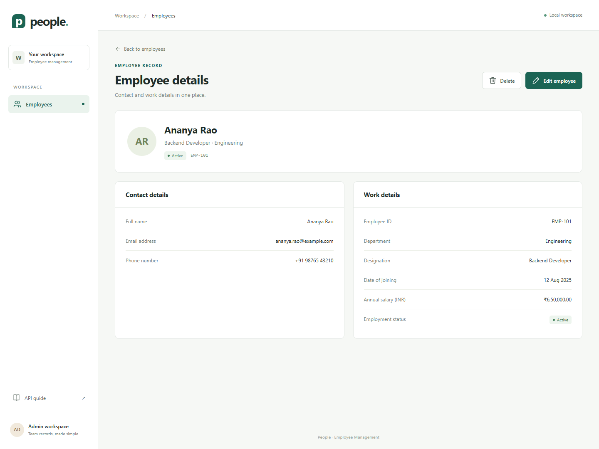
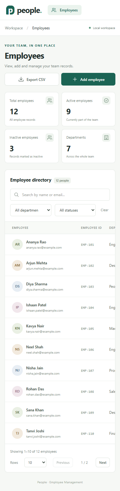

# Employee Management

A web app to keep employee records in one place. An admin can add, view, edit and delete employees. The app also has search, filters and pages for long lists.

## What is included

- All nine employee fields from the assessment.
- A list page, add form, edit form and details page.
- Search by name or email, with department and status filters.
- A check before deleting a record.
- Checks for required fields, email format, salary and duplicate records.
- PostgreSQL storage and database setup files.
- REST APIs with Swagger UI and a Postman collection.
- JUnit 5 and Mockito tests, plus PostgreSQL and browser tests.
- CSV export and Docker Compose setup.

## Tools used

| Part | Tool |
| --- | --- |
| Backend | Java 17, Spring Boot 3.5.7, Spring Data JPA |
| Database | PostgreSQL 17, Flyway |
| Frontend | HTML, CSS and JavaScript |
| Tests | JUnit 5, Mockito, MockMvc, Playwright |
| Build and API guide | Maven, springdoc OpenAPI |

The frontend is in `src/main/resources/static`. Spring Boot serves both the pages and the API. There is no separate frontend build.

## Start with Docker

You need Docker Desktop with Docker Compose. Start Docker before running these steps. Java, Maven and Node.js are not needed for this method.

1. Open a terminal in this project folder.
2. Run:

   ```sh
   docker compose up --build -d
   ```

3. The first build needs internet access and may take a few minutes. Check the app log:

   ```sh
   docker compose logs -f app
   ```

   Wait for `Started EmployeeApplication`. Press Ctrl+C to leave the log view. The app will keep running.

4. Open [http://localhost:8080](http://localhost:8080).

The database and tables are made on the first start. The employee list starts empty. Records stay in a Docker volume when the app stops.

To stop the app and keep the data:

```sh
docker compose down
```

## Load sample records

This step is optional. It adds 12 sample employees with example email addresses. Running it again skips records that already exist.

On Windows PowerShell:

```powershell
powershell -ExecutionPolicy Bypass -File scripts/load-demo.ps1
```

On macOS or Linux:

```sh
sh scripts/load-demo.sh
```

Refresh the page after loading the records.

## Run with local Java and Maven

You need JDK 17 or later, Maven 3.6.3 or later, and PostgreSQL 17. This option can also use the database from Docker.

```sh
docker compose up -d db
mvn spring-boot:run
```

Do not start the Docker `app` service at the same time as the local app on the same port. If it is running, use `docker compose stop app` first.

Default database settings:

| Setting | Default value |
| --- | --- |
| Host and port | `localhost:15432` |
| Database | `employees` |
| User | `employee_app` |
| Password | `employee_local` |

For a fresh PostgreSQL server, run this once as the `postgres` user:

```sh
psql -U postgres -v ON_ERROR_STOP=1 -f database/setup-local.sql
```

This makes the app user and both databases. If you already have a database user, you can instead make an empty database named `employees` owned by that user. Set `DB_URL`, `DB_USER` and `DB_PASSWORD` in your terminal before starting Maven. Flyway will create the tables.

Example in PowerShell:

```powershell
$env:DB_URL = 'jdbc:postgresql://localhost:5432/employees'
$env:DB_USER = 'employee_app'
$env:DB_PASSWORD = 'employee_local'
mvn spring-boot:run
```

## Change Docker ports or settings

Copy `.env.example` to `.env` and change the values you need. The default app port is `8080`; the database port is `15432`. For example, set `APP_PORT=8086` if port 8080 is busy, then open `http://localhost:8086`.

Run `docker compose up --build -d` after making changes. Database name, user and password apply when the database volume is first made. Changing these values later does not change an existing database user.

The Docker `.env` file is read by Docker Compose. A local Maven run reads the environment variables from your terminal. For a local app port, set `PORT`.

## API guide

- Swagger UI: [http://localhost:8080/swagger-ui.html](http://localhost:8080/swagger-ui.html)
- OpenAPI JSON: [http://localhost:8080/v3/api-docs](http://localhost:8080/v3/api-docs)
- Postman collection: `docs/employee-management.postman_collection.json`
- Ready-to-use requests: `docs/api-examples.http`

| Method | Path | Use |
| --- | --- | --- |
| GET | `/api/employees` | List, search and filter employees |
| GET | `/api/employees/{id}` | View one employee |
| POST | `/api/employees` | Add an employee |
| PUT | `/api/employees/{id}` | Update all employee fields |
| DELETE | `/api/employees/{id}` | Delete an employee |
| GET | `/api/employees/departments` | List departments used in records |
| GET | `/api/employees/summary` | Count all employees and departments |
| GET | `/api/employees/export` | Export all matching records as CSV |

Example:

```text
/api/employees?search=rao&department=Engineering&status=ACTIVE&page=0&size=5
```

Pages start at `0`. Page size can be `1` to `100`. Results are sorted by name, then by record ID. Search matches part of a name or email and ignores letter case. The department filter also ignores case. All filters work together. CSV export uses the same filters and includes every matching row.

The API returns a numeric `id` for each database record. Use that number in API paths. `employeeId`, such as `EMP-101`, is the separate ID shown on the employee form.

## Record rules

- All fields are required. Text values are trimmed before they are saved.
- Employee IDs can use up to 20 letters, numbers or hyphens. IDs are saved in upper case.
- Emails are saved in lower case. Email and employee ID must each be unique, even if letter case differs.
- Salary is an annual amount in INR. It can be zero or more, with up to two decimal places.
- Phone numbers can include a leading `+`, spaces, brackets and hyphens. Use 7 to 20 characters.
- Dates use `YYYY-MM-DD`. Future joining dates are allowed.
- Status must be `ACTIVE` or `INACTIVE`.
- Department names are entered on the employee form. The filter list comes from the saved records.

Bad input returns `400`, missing records return `404`, and duplicate records return `409`. Form errors appear next to the related field.

## Run the tests

Service and API tests do not need a database:

```sh
mvn test
```

Or run them with Docker:

```sh
docker compose --profile test run --rm tests mvn -B test
```

To run all Java tests, including real PostgreSQL tests:

```sh
docker compose --profile test run --rm tests
```

The database setup creates `employee_tests` for these tests. They clear only that test database. The test setup checks that its database name ends in `_tests` before removing any rows.

For a local Maven run, start the database and use:

```sh
mvn verify -Pintegration
```

If you use your own PostgreSQL server, create `employee_tests` first. Set `TEST_DB_URL`, `TEST_DB_USER` and `TEST_DB_PASSWORD` to its details. Keep this database separate from employee data.

Browser tests need Node.js 20 or later. Start the app, then run:

```sh
npm ci
npx playwright install chromium
npm run test:ui
```

For a different app address, set `APP_URL`, for example `http://localhost:8086`. The browser tests add temporary records and remove them when each test ends.

See `docs/test-results.md` for the checks run on this version.

## Project files

```text
src/main/java/com/example/employees/
  employee/             Employee model, API, service, filters and database access
  error/                Error messages and response handling
  config/               OpenAPI setup
src/main/resources/
  static/               Frontend pages, styles and scripts
  db/migration/         Table setup through Flyway
src/test/               Service, API and PostgreSQL tests
database/               Test database setup and sample records
e2e/                    Browser tests
docs/                   API requests, test notes and screenshots
scripts/                Sample data scripts
```

The controller reads each request. The service checks business rules. The repository reads and writes PostgreSQL. Database constraints also block duplicate records if two requests arrive at the same time.

## Screenshots

The screenshots show the running app with the sample records.







## Notes

This is a local assessment app. It has no login screen. CSV cells are escaped, and text that could run as a spreadsheet formula is stored as plain text in the export.

Tool references: [Spring Boot setup](https://docs.spring.io/spring-boot/3.5/system-requirements.html) and [springdoc compatibility](https://springdoc.org/v2/).
